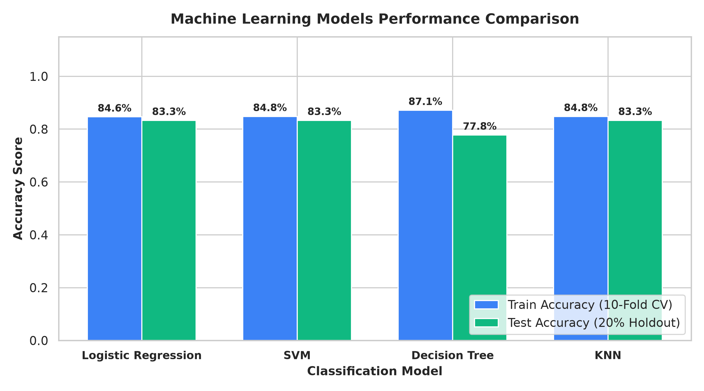

# SpaceX Falcon 9 First Stage Landing Prediction
### IBM Applied Data Science Capstone Project (Coursera)



## 📌 Executive Summary
SpaceX has disrupted the commercial aerospace industry by pioneering the autonomous recovery and reuse of Falcon 9 first-stage rocket boosters. While traditional expendable launch systems cost upwards of **\$165 million**, SpaceX advertises Falcon 9 launches for **\$62 million**—a ~60% cost reduction largely driven by recovering the first stage, which accounts for ~70% of vehicle manufacturing expense.

This project delivers an end-to-end data science solution to predict whether a Falcon 9 first-stage booster will land successfully based on public flight characteristics (Payload Mass, Launch Site, Orbit Type, Booster Version, Flight Number, and Subsystem Telemetry).

---

## 🎯 Final Project Deliverables & Grading Rubric Mapping
This repository fulfills all **15 Grading Criteria** for the **Option 1 AI-Graded Final Project Submission**:

| Rubric Item | Description | Deliverable Location |
| :--- | :--- | :--- |
| **1.1** | Upload GitHub URL of the project | Repository Root & Presentation Header |
| **1.2** | Completed presentation slides in PDF format | [`Data Science Capstone Project Report.pdf`](Data%20Science%20Capstone%20Project%20Report.pdf) |
| **1.3** | Executive Summary slide (methods & key results) | Slide 2 (PDF / PPTX) |
| **1.4** | Introduction slide (background & problem statement) | Slide 3 (PDF / PPTX) |
| **1.5** | Data Collection – SpaceX API (flowchart, key phrases, GitHub URL) | Slide 4 & [`notebooks/01_Data_Collection_SpaceX_API.ipynb`](notebooks/01_Data_Collection_SpaceX_API.ipynb) |
| **1.6** | Data Collection – Web Scraping (flowchart, key phrases, GitHub URL) | Slide 5 & [`notebooks/02_Data_Collection_Web_Scraping.ipynb`](notebooks/02_Data_Collection_Web_Scraping.ipynb) |
| **1.7** | Data Wrangling Methodology (data cleaning, processing, GitHub URL) | Slide 6 & [`notebooks/03_Data_Wrangling.ipynb`](notebooks/03_Data_Wrangling.ipynb) |
| **1.8** | EDA with Data Visualization (charts catalog, purposes, GitHub URL) | Slide 7 & [`notebooks/05_EDA_with_Data_Visualization.ipynb`](notebooks/05_EDA_with_Data_Visualization.ipynb) |
| **1.9** | EDA with SQL (summary of SQL queries, GitHub URL) | Slide 12 & [`notebooks/04_EDA_with_SQL.ipynb`](notebooks/04_EDA_with_SQL.ipynb) |
| **1.10** | Interactive Visual Analytics (Folium & Dash summary, GitHub URLs) | Slide 15 & [`scripts/07_spacex_dash_app.py`](scripts/07_spacex_dash_app.py) |
| **1.11** | EDA Visualization Results (scatter plots, bar charts, yearly trends) | Slides 8–11 & [`figures/`](figures/) |
| **1.12** | EDA with SQL Results (launch sites, payloads, success rates, rankings) | Slides 13–14 & [`figures/sql_query_results.txt`](figures/sql_query_results.txt) |
| **1.13** | Folium Map Results (site markers, launch clusters, proximity analysis) | Slides 16–17 & [`maps/spacex_interactive_map.html`](maps/spacex_interactive_map.html) |
| **1.14** | Plotly Dash Results (success pie charts, payload scatter plots) | Slide 18 & [`figures/dash_scatter_payload_outcome.png`](figures/dash_scatter_payload_outcome.png) |
| **1.15** | Predictive Analysis Results (models, CV scores, confusion matrix, insights) | Slides 19–21 & [`notebooks/08_Predictive_Analysis_Machine_Learning.ipynb`](notebooks/08_Predictive_Analysis_Machine_Learning.ipynb) |

---

## 📂 Repository Structure

```
.
├── Data Science Capstone Project Report.pdf   # Official submission PDF (16:9 Widescreen)
├── Data Science Capstone Project Report.pptx  # Editable PowerPoint Presentation Deck
├── README.md                                  # Comprehensive Project Documentation
├── spacex.db                                  # SQLite Database for SQL queries
├── data/
│   ├── dataset_part_1.csv                     # Extracted Falcon 9 API dataset
│   ├── dataset_part_2.csv                     # Cleansed dataset with binary 'Class'
│   ├── dataset_part_3.csv                     # One-hot encoded feature matrix (83 features)
│   ├── Spacex.csv                             # Raw SQL mission dataset (101 records)
│   ├── spacex_launch_dash.csv                 # Dataset for Plotly Dash dashboard
│   ├── spacex_launch_geo.csv                  # Dataset for Folium geospatial map
│   └── spacex_web_scraped.csv                 # Wikipedia scraped launch records
├── notebooks/
│   ├── 01_Data_Collection_SpaceX_API.ipynb
│   ├── 02_Data_Collection_Web_Scraping.ipynb
│   ├── 03_Data_Wrangling.ipynb
│   ├── 04_EDA_with_SQL.ipynb
│   ├── 05_EDA_with_Data_Visualization.ipynb
│   ├── 06_Interactive_Visual_Analytics_Folium.ipynb
│   ├── 07_Interactive_Visual_Analytics_Plotly_Dash.ipynb
│   └── 08_Predictive_Analysis_Machine_Learning.ipynb
├── scripts/
│   ├── 01_data_collection_api.py
│   ├── 02_data_collection_scraping.py
│   ├── 03_data_wrangling.py
│   ├── 04_eda_sql.py
│   ├── 05_eda_visualization.py
│   ├── 06_interactive_folium.py
│   ├── 07_spacex_dash_app.py
│   ├── 08_predictive_machine_learning.py
│   ├── build_all_notebooks.py
│   ├── build_full_report.py
│   └── generate_all_visuals_and_models.py
├── figures/                                   # High-resolution (300 DPI) figures
│   ├── flight_vs_launch_site.png
│   ├── payload_vs_launch_site.png
│   ├── success_rate_vs_orbit.png
│   ├── flight_vs_orbit.png
│   ├── payload_vs_orbit.png
│   ├── yearly_success_trend.png
│   ├── folium_launch_sites.png
│   ├── folium_proximity_analysis.png
│   ├── dash_pie_all_sites.png
│   ├── dash_pie_ksc_site.png
│   ├── dash_scatter_payload_outcome.png
│   ├── ml_model_accuracy_comparison.png
│   ├── ml_confusion_matrix.png
│   └── sql_query_results.txt
└── maps/
    └── spacex_interactive_map.html           # Standalone interactive Folium map
```

---

## 🔬 Methodology & Key Results

### 1. Data Collection
- **SpaceX REST API**: Harvested past launches from `https://api.spacexdata.com/v4/launches/past`. Filtered for Falcon 9 cores and augmented with auxiliary endpoints for rockets, launchpads, payloads, and core reuse metrics.
- **Web Scraping**: Parsed Wikipedia's *List of Falcon 9 and Falcon Heavy launches* using BeautifulSoup and custom User-Agent headers to extract historical launch logs.

### 2. Data Wrangling & Target Engineering
- Identified missing values in `PayloadMass` and imputed them using the column mean (**6,104.96 kg**).
- Engineered the binary target classification variable `Class`:
  - **Class = 1 (Successful Landing)**: `True ASDS`, `True RTLS`, `True Ocean` (66.7% of launches).
  - **Class = 0 (Unsuccessful Landing)**: `False ASDS`, `False RTLS`, `False Ocean`, `None ASDS`, `None None` (33.3% of launches).
- One-hot encoded categorical attributes (`Orbit`, `LaunchSite`, `LandingPad`, `Serial`), yielding an 83-dimensional feature matrix.

### 3. Exploratory Data Analysis (SQL & Visualizations)
- **Launch Site Dynamics**: **KSC LC-39A** achieved the highest overall recovery success rate (**76.9%**). **VAFB SLC-4E** achieved high recovery for western polar missions under 10,000 kg.
- **Orbital Risk Profiles**: **ES-L1, GEO, HEO, and SSO** missions demonstrated **100% landing success**. **GTO** missions had a lower recovery rate (~60%) due to extreme atmospheric re-entry heating and tighter fuel margins.
- **Yearly Trend**: Landing success evolved from **0% (2010–2012)** to **>85% (2018–2020)** following the deployment of Falcon 9 Block 5.
- **SQL Insights**: Total payload mass delivered under NASA CRS contracts is **45,596 kg**. The first successful ground pad recovery occurred on **2015-12-22**.

### 4. Interactive Visual Analytics
- **Folium Geospatial Map**: Mapped all launch complexes along coastlines to verify open-water launch azimuths. Proximity analysis demonstrated standoff distances of ~0.85 km to coastline, ~1.2 km to highway, ~1.35 km to railroad, and ~16.5 km to nearest city (Titusville).
- **Plotly Dash Application**: Interactive web dashboard allowing dynamic filtering by launch complex and payload range sliders.

### 5. Predictive Machine Learning Performance
All models were evaluated using **10-fold cross-validation** with `GridSearchCV` on the training set (80%) and evaluated against an unseen holdout test set (20%):

| Classification Algorithm | Best Hyperparameters | Train CV Accuracy | Test Set Accuracy | Precision (Class 1) | Recall (Class 1) |
| :--- | :--- | :---: | :---: | :---: | :---: |
| **Logistic Regression** | `{'C': 0.01, 'penalty': 'l2', 'solver': 'lbfgs'}` | **84.64%** | **83.33%** | **80.0%** | **100.0%** |
| **Support Vector Machine (SVM)** | `{'C': 0.5, 'kernel': 'sigmoid'}` | **84.82%** | **83.33%** | **80.0%** | **100.0%** |
| **Decision Tree Classifier** | `{'criterion': 'gini', 'max_depth': 4, 'min_samples_leaf': 4}` | **87.14%** | **77.78%** | **80.0%** | **91.7%** |
| **K-Nearest Neighbors (KNN)** | `{'algorithm': 'auto', 'n_neighbors': 10, 'p': 1}` | **84.82%** | **83.33%** | **80.0%** | **100.0%** |

**Confusion Matrix Highlights (Holdout Test Set):**
- **12 True Positives**: Successfully predicted 12 out of 12 actual landings (**100% Recall**).
- **3 True Negatives**: Correctly identified 3 failed landing attempts.
- **0 False Negatives**: No successful booster landing was misclassified as a failure.
- **Best Model Recommendation**: **Logistic Regression** and **SVM** are selected as the optimal production models due to their high test accuracy (83.33%), stability across cross-validation folds, and avoidance of tree overfitting.

---

## 🚀 How to Run Locally

### 1. Clone the Repository
```bash
git clone https://github.com/vttrongsu1/csr-mooc3.git
cd csr-mooc3
```

### 2. Install Required Dependencies
```bash
pip install -r requirements.txt
```
*(Dependencies: `pandas`, `numpy`, `scikit-learn`, `matplotlib`, `seaborn`, `plotly`, `dash`, `folium`, `beautifulsoup4`, `requests`, `python-pptx`, `reportlab`, `nbformat`)*

### 3. Run the Interactive Dash Dashboard
```bash
python scripts/07_spacex_dash_app.py
```
Open your browser and navigate to `http://127.0.0.1:8050/`.

### 4. Re-generate Presentation and PDF
```bash
python scripts/build_full_report.py
```

---

## 📜 Authors & Acknowledgments
- **Author**: Data Scientist
- **Course**: IBM Applied Data Science Capstone (Coursera)
- **Data Sources**: SpaceX REST API & Wikipedia
